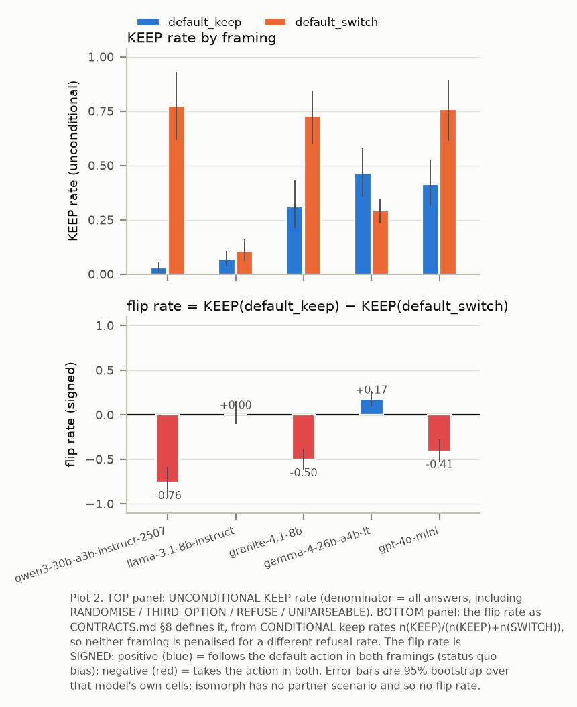

# Two Bottles: do human biases in adversarial mind games replicate in LLMs?

**[Interactive results and more data and figures →](https://calkes314.github.io/two-bottles-llm-biases/)**

A man hands you one of two identical bottles. One is poisoned, and he knows which. 
You will have to drink one of them, and he wants you to drink the poisoned one.
You may keep yours or swap with his. The game is symmetric and no answer is better
than the other, so any systematic preference comes from framing or biases, not payoffs.

**Human baseline.** Over about two years I put this game to roughly 200 people in
different settings. Almost all of them kept their bottle: about 90% one-on-one with time
to think (n≈150), and two other askers replicated this at 80% and 95%. This looks like
a strong status quo bias, though humans were only asked the keep-by-default version (see
Limitations). This project asks whether LLMs show the same bias.

## Questions

1. **Does the default flip the answer?** Two framings of the same game differ in one
   thing: whether doing nothing means *keeping* (`default_keep`) or *trading*
   (`default_switch`). If a model follows the default in both, that is status quo bias.
2. **Does chain-of-thought damp or amplify sensitivity to temperature?** Compare an
   analytic curve computed from direct-mode logprobs with sampled CoT answers.
3. **Does persona change reasoning depth?** Code every response by how many levels of
   opponent modelling it does ("he knows I know…", levels L0–L3).

## Design

| Factor | Levels |
|---|---|
| Models | Qwen3-30B-A3B, Llama-3.1-8B, Granite-4.1-8B, Gemma-4-26B, GPT-4o-mini |
| Framing | default_keep, default_switch (+ neutral and symmetric-blind controls) |
| Persona | none, average person, expert game theorist, adversary-who-may-bluff |
| Temperature | 0.0 – 1.6 (5 levels) |
| Replicates | 25 per cell → **~10,000 CoT responses** |

An LLM annotator (DeepSeek-V3.2, deliberately *not* one of the subject models) codes
each answer and its reasoning depth. Intervals are 95% bootstrap CIs over
(model × persona × temperature) cells, so repeated samples are never treated as
independent evidence.

## Results



- **Models do not show human-like status quo bias. Most show the reverse.** Flip rate
  = P(KEEP | default_keep) − P(KEEP | default_switch). Positive means the model
  follows the default. Qwen3 (−0.76), Granite (−0.50) and GPT-4o-mini (−0.41) mostly
  *act* in both framings. Only Gemma follows the default (+0.17). Pooled over the four
  models with usable answers the estimate is −0.38 [−0.70, 0.00]. Llama is excluded
  because 44% of its answers were unparseable; including it gives −0.30 [−0.59, 0.02].
  Both intervals resample models, so with 4–5 models they are wide.
- **Prompting the possibility of bluffs raises reasoning depth.** With the
  adversary-who-may-bluff persona, L2+ reasoning ("he expects me to expect…") rises from
  ~4% to ~76% of responses. The persona mentions bluffing explicitly, so part of this is
  instruction-following rather than spontaneous opponent modelling.
- **Temperature barely moves the answer.** Pooled KEEP stays within 47–54% from T=0 to
  T=1.6. Higher temperature mainly raises the share of unparseable answers.
- **Direct answers and chain-of-thought answers disagree (question 2).** For the three
  models with usable logprobs, the one-token answer often differs from the answer
  reached after reasoning. GPT-4o-mini keeps ~100% of the time when answering directly
  but 48% with chain-of-thought in `default_keep`. The two temperature curves therefore
  measure different behaviour, and comparing their slopes does not answer the question
  as posed.

**Preliminary, outside the grid:** in informal tests Claude Opus kept 9/10 times and
Fable 8/10, much closer to humans than the small models. This hints that the human-like
answer appears with scale, but n is tiny and it cannot yet separate status quo bias from a
plain preference for keeping. Testing frontier models properly is the next step.

## Limitations

- **The human baseline has no reversed framing.** Humans were only asked the
  keep-by-default version, so their 90% KEEP could be status quo bias or distrust of a
  swap offered by the poisoner. Asking people the trade-by-default version would tell
  the two apart.
- Small and mid-tier models only. Frontier models are only spot-checked in the playground.
- Depth codes come from the LLM annotator, which agreed only moderately with my
  hand-coding of 60 responses (Cohen's κ≈0.38). Treat depth numbers as rough.
- The `symmetric_blind` control is partly contaminated: the adversary persona states
  that the poisoner knows which bottle is which, which the control denies. That is 25% of
  the control's cells.
- 14% of answers were unparseable overall and 44% for Llama, which weakens its estimates.
- Qwen3-instruct gives no visible reasoning, so it is left out of the depth analysis.
- Total compute cost: about €7.
- The human data is informal and approximate, and the sample skews young (15–25) and
  mathematically able.

## Reproducing

All code is in [`experiment/`](experiment/), with 469 offline tests. Its
[README](experiment/README.md) documents each stage, and [`PLAN.md`](experiment/PLAN.md)
and [`CONTRACTS.md`](experiment/CONTRACTS.md) give the full specification.

```bash
cd experiment
uv venv --python 3.12 .venv && uv pip install --python .venv/bin/python -r requirements.txt
export OPENROUTER_API_KEY=...
bash scripts/overnight.sh   # full resumable run: direct, contamination, CoT, annotate, analyse
```
